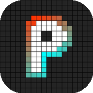
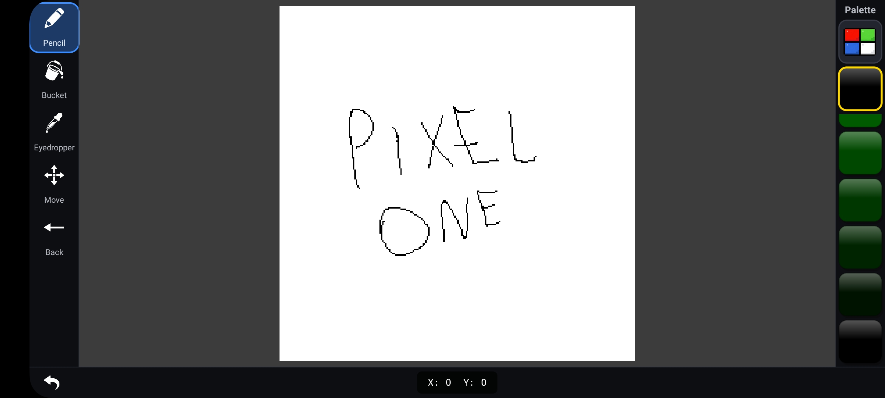
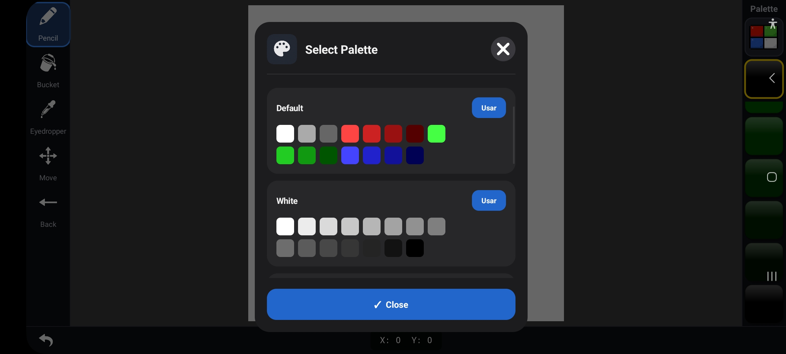
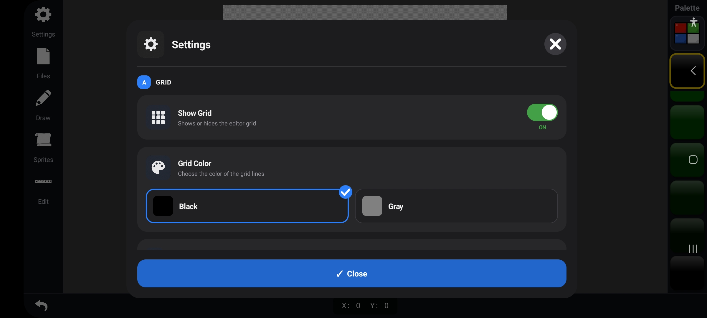

# PixelOne

**A pixel art editor for Android.**
Open it, draw, done.

[Screenshots](#-screenshots) · [Features](#-features) · [What happened](#-what-happened-to-the-release) · [Roadmap](#%EF%B8%8F-roadmap) · [Contributing](#-contributing)

**If this project looks like something you'd use, a ⭐ star really helps it get found. Costs nothing, means a lot.**

---

> [!NOTE]
> **No public APK yet** — PixelOne is in its final stretch before a first public release. The editor itself is done: canvas, tools, files, palettes, sprite sheets. What's left is polish, testing and bug hunting. See the [target date](#-roadmap) below.

## 👋 About

PixelOne is a pixel art editor for Android, made for sprites, textures and small pixel art projects without any extra fuss.

The idea came up when I was trying to make a texture for Minecraft PE and couldn't find an editor that fit what I needed. Most of the ones I tried felt outdated or too generic, so I built my own.

It's for artists, developers, or anyone who just wants to make pixel art without fighting the app.

---

## 📸 Screenshots

> [!NOTE]
> These screenshots are from an older version. The rewrite looks a bit different, but the general idea is the same — fresh ones go up closer to release.

<table>
  <tr>
    <td align="center"> Canvas</td>
    <td align="center"> Color palette</td>
  </tr>
  <tr>
    <td align="center"> Settings</td>
  </tr>
</table>

---

## 😴 What happened to the release

Short version: I got lazy, then I made it worse.

The project already had a rough time. The Java to Kotlin migration and a big UI refactor took way longer than planned, and the release date got pushed back more than once. Somewhere along the way, laziness took over and progress crawled.

Then release day came. And I deleted the APK together with the whole project. Same day. Yes, on purpose or not, it doesn't matter, it's gone.

<strong>So what now?</strong> (click to expand)

 

I rebuilt PixelOne from zero, using the bits of old code I still had as reference. The code is cleaner this time, the structure is organized by topic, and the whole thing is built to run on as many devices as possible instead of just mine.

It took longer than I'd like to admit, but the editor is now feature-complete for a first release. What's left is testing, polishing rough edges, and squashing whatever bugs show up along the way — not new features.

### 🧱 Rewrite progress

| Part | Status |
|---|:---:|
| Splash screen | ✅ Done |
| Custom pixel font | ✅ Done |
| Sidebar | ✅ Done |
| Canvas and drawing tools | ✅ Done |
| Mirror / symmetry tool | ✅ Done |
| Stamp tool (copy, paste, flip, rotate) | ✅ Done |
| Save and open files | ✅ Done |
| Sprite sheet generator | ✅ Done |
| Core settings (grid, checkerboard, layout) | ✅ Done |
| **V1 editor** | ✅ **Feature complete** |

---

## ✨ Features

| Tool | Description |
|---|---|
| ✏️ Pencil | Basic drawing tool |
| 🪣 Paint bucket | Fill areas fast |
| 🎯 Color picker | Grab any color from the canvas |
| ✋ Move | Shift the whole canvas around while you work |
| 🔺 Shapes | Line, square and circle, filled or outlined |
| 🪞 Mirror | Draw with horizontal, vertical or diagonal symmetry |
| 📋 Stamp | Copy a selection and drop flipped/rotated copies of it |
| 🎨 Color palette | Curated color decks, plus your own recently-used colors |
| 🔍 Zoom | Get in close for detail work |
| 🔳 Grid view | Toggle the pixel grid |
| 📐 Grid & canvas size | Fully customizable, up to `4096x4096` |
| ↩️ Undo / redo | Full history support |
| 📥 Import | Open an image from storage, or straight from another app's "Open with" |
| 📤 Export | Save as PNG or JPG, from an in-app file browser |
| 🖼️ Sprite sheet generator | Combine multiple images into one packed sheet |

> [!TIP]
> Very large projects can get slow on lower-end devices. Performance tuning is planned for a later update — see [Roadmap](#%EF%B8%8F-roadmap).

---

## ⚠️ Project status and risks

Development doesn't move at a steady pace. Sometimes there are days without commits. It doesn't mean the project is dead, it means I'm slow.

There are some real risks too:

- **Google's sideload restrictions.** Stricter rules for installing apps outside the Play Store could make distributing a standalone APK harder, or impossible, down the line.
- **No budget for the Play Store.** Publishing there needs a one-time $25 fee, which I can't afford right now.
- **Hardware.** My PC can't run Android Studio properly, so I work with a more limited setup (no Gradle, building straight from Termux). If I have to stop, picking it up again in a proper environment could take a long time.

If development pauses or ends, this README will say so honestly.

---

## 🗺️ Roadmap

### V1 — the editor itself

- [x] Rewrite: splash, pixel font, sidebar
- [x] Canvas with pixel drawing, up to 4096x4096
- [x] Mirror tool and stamp tool
- [x] Sprite sheet generator
- [x] Save and open files
- [x] Core settings

**Target: first public build around early 2027.** No fixed day yet on purpose — that window is there to actually test on different devices, chase down bugs, and polish rough edges instead of rushing it out and regretting it (see [what happened last time](#-what-happened-to-the-release)).

### V2 and beyond

Everything here is a "later" problem, not a blocker for V1:

- [ ] **Layers** for outlines, base colors, shading and details
- [ ] **Animation / frames**, with onion skinning
- [ ] Free-form selection (lasso, select-by-color)
- [ ] Whole-canvas flip and rotate (today it's just the stamp selection)
- [ ] Adjustable brush size (today it's 1px only)
- [ ] Custom, savable color palettes (import/export)
- [ ] App themes beyond dark mode
- [ ] Font switcher (pixel / system / custom)
- [ ] Settings & palette backup (export/import)
- [ ] Performance work for big canvases and sheets
- [ ] Discord server (I still haven't set it up, sorry)
- [ ] Whatever comes up from real usage and feedback

---

## 🤝 Contributing

Suggestions, bug reports and feedback are welcome. Just open a [GitHub Issue](../../issues).

Found this project useful, interesting, or just want to keep an eye on it? **A star helps more than you'd think** — it's the easiest way to tell me it's worth finishing well.

## 📄 License

No license added yet. All rights reserved.

Made with too much coffee and not enough motivation.

